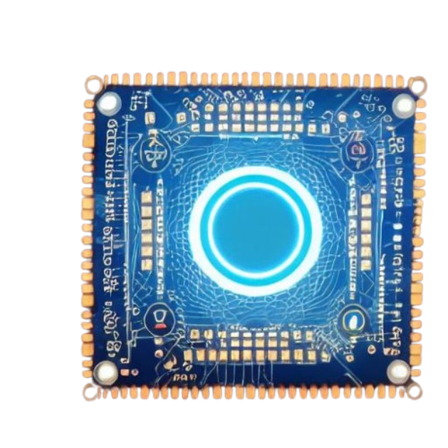

<h1>EspScope</h1>

  

## Description

This project is a DIY, low cost osciloscope based on ESP32 C3 microcontroller.
It uses an external machine (PC) as a display and also for performing heavy calculations.

## Project components

- [firmware](./firmware) contains a ESP-IDF project flashed to the microcontroller
- [case](./case) contains 3D-printed case for the device.
- [PCB](./PCB) PCB production files
- The rest of the repo contains a go module for the desktop application.

## How it works?

- A simple voltage divider and an amplifier are converting the input voltage so that it is suitable for the EPS32's ADC input.
- ESP32 reads adc value and sends it to the Host PC.
- EspScope Application receives raw ADC data, converts it back to the appropiate units and presents on the UI.

## Voltage range

> [!note]
> The circuit contains overvoltage protection (a set of diods) so it **should** not be damaged by the out-of-range voltage.
> HOWEVER:
> - this was not verified
> - The amplifier (U1.1) outputting overvoltage (5V) should not be the problem due to a shotkey diode which will push it to the ESP's 3.3V regulator (should be save).
> - (This is only a thoery): When voltage on the amplifier (U1.1) is out of its range, it could damage the amplifier.

According to the [schematic](PCB/EspScope_schematic.pdf) the following formula gives $V_{min}$ and $V_{max}$:

$$
V_o = \left(\frac{V_i}{R_1} + \frac{3.3 V}{R_2}\right) * \left(\frac{R_1 R_2 R_3}{R_1 R_2 + R_2 R_3 + R_1 R_3}\right)
$$

Then you can calculate $V_{min}$ and $V_{max}$ with the following formulas:

$$
\begin{aligned}
V_{\min} &= -3.3\,\text{V}\frac{R_1}{R_2} \\
V_{\max} &= 3.3\,\text{V}\left(1+\frac{R_1}{R_3}\right)
\end{aligned}
$$

> [!tip]
> With those formulas, you can choose $R_1$, $R_2$, $R_3$ resistors so that the scope range fits your needs.
> Project recommended values are: $R_1 = 1M \Omega$, $R_2 = 240 k\Omega$ and $R_3 = 316k\Omega$. This setting allows for **input voltage range** $V_i = \pm 13.7V$

> [!important]
> Please keep your resistors values larger than smaller.
> You **don't want** your scope to draw a significient amount of current.
> For the recommended settings, the scope draws $I_{max} \approx 10 \mu A$.
